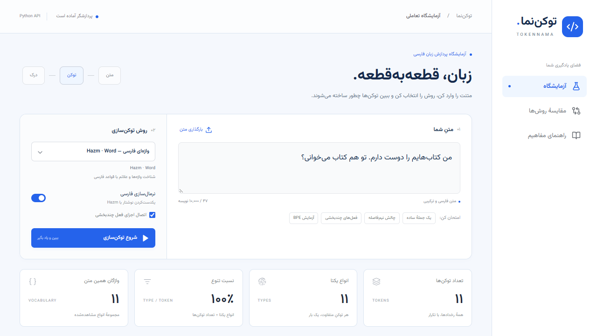
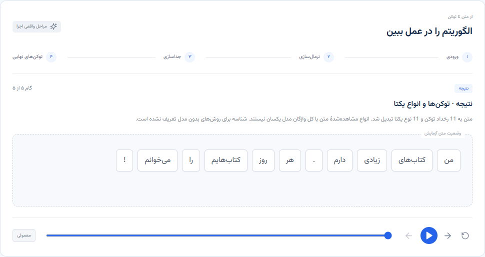
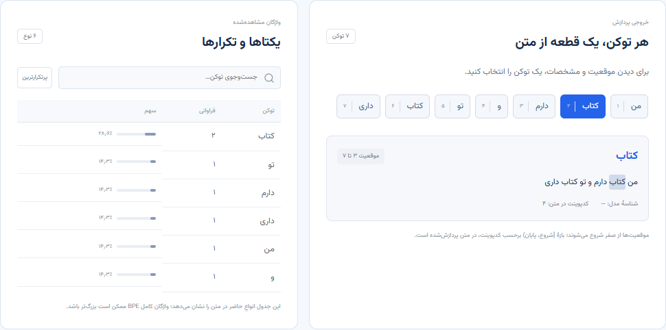
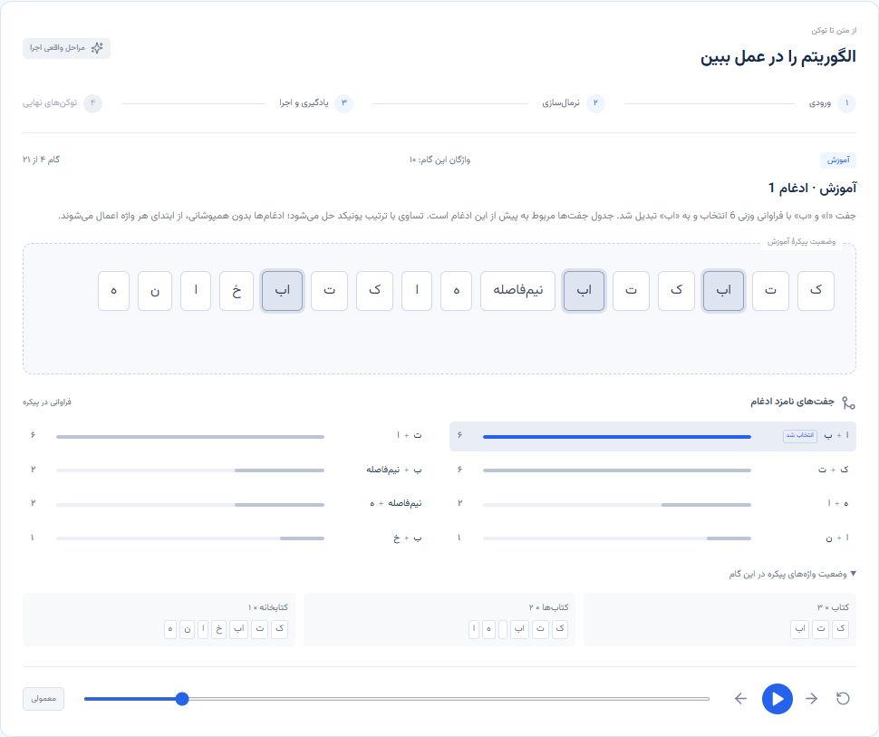
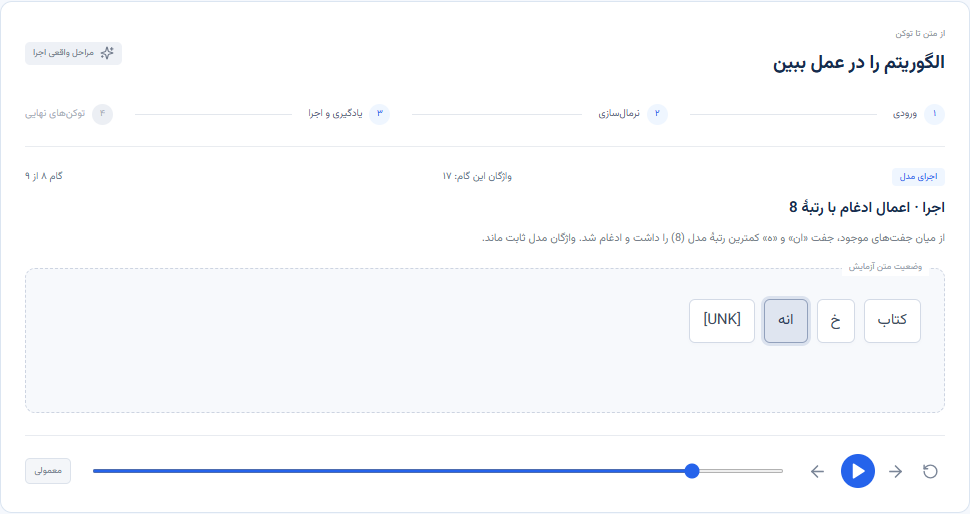
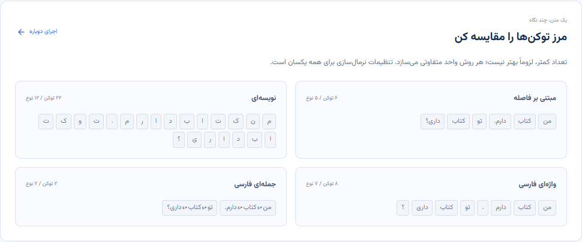

# TokenNama — Persian Tokenizer Lab

An interactive, Persian-language learning lab for understanding tokenization. Enter a sentence, compare token boundaries, inspect observed vocabulary types, and walk through the decisions of an educational Byte-Pair Encoding (BPE) implementation.

The interface is written in Persian and supports right-to-left text. Source files and project directories use English names for maintainability and future GitHub publication.

## Features

- Whitespace, Unicode code-point, Hazm word, and Hazm sentence tokenization.
- Optional Persian text normalization with Hazm.
- Character-based BPE training on a small corpus, followed by encoding a separate input with the learned merge ranks.
- Step navigation and playback, including actual BPE pair counts and merge decisions.
- Token counts, observed types, frequencies, type-token ratio, and model vocabulary size where applicable.
- Comparison of the four basic tokenizers on the same text.
- Persian examples for half-spaces, Arabic/Persian letter variants, repeated words, punctuation, and multi-part verbs.

This first release focuses on the basic tokenizers and BPE. WordPiece and Unigram are future extensions.

## Visual walkthrough

Follow one analysis from text entry to token inspection, then explore how BPE training differs from encoding with a fixed model.

### 1. Enter text and select a tokenizer



Enter a Persian sentence or load a text file, then choose a tokenizer and its options. Enable Hazm normalization to standardize the input before tokenization.

### 2. Inspect the Hazm tokenization result



Move through the recorded stages to inspect the processed text and the tokens returned by Hazm. These stages show actual library calls and outputs; they do not expose every internal Hazm rule.

### 3. Explore tokens, observed types, and frequencies



With normalization disabled, whitespace tokenization of `من کتاب دارم و تو کتاب داری` produces **7 tokens** and **6 observed types**, with `کتاب` appearing twice. Select a token to highlight its span in the processed text, and inspect its frequency in the vocabulary table.

### 4. Follow a BPE training merge



BPE counts adjacent pairs across the training corpus, weighted by word frequency, and merges the most frequent pair. The candidate table shows counts before the selected merge, while the pieces show the corpus state after that merge.

### 5. Encode new text with a fixed BPE model



Switch to fixed-model encoding and enter `کتابخانه 🐈` to apply the learned merge ranks while keeping the vocabulary unchanged. An emoji outside the learned base alphabet becomes `[UNK]`; the input is not used to retrain the model.

### 6. Compare tokenizer boundaries



Compare the four baseline tokenizers using the same input and normalization setting. Each method produces a different unit—whitespace-delimited pieces, code points, words, or sentences—so a smaller token count is not a quality score.

[View the mobile layout](docs/images/laboratory-mobile.png).

## Stack

| Area | Technology |
| --- | --- |
| User interface | Vite, React, TypeScript |
| API | Python, FastAPI, Pydantic |
| Persian preprocessing | Hazm |
| BPE learning engine | A small, traceable Python implementation |
| Backend verification | pytest and HTTPX |

## Requirements for a fresh clone

- Node.js 22.12 or newer in a supported LTS release, with npm.
- Python 3.12 or 3.13. The pinned Hazm release does not support Python 3.14.
- Internet access for the initial dependency installation.

Dependencies are installed inside the project. No administrator account, global Python packages, or system execution-policy changes are required.

## Prepared Windows delivery

If this local copy includes `.runtime/python312/python.exe` and the installed frontend dependencies, launch it directly with `Start-TokenNama.cmd` or `npm.cmd start`. The launcher first looks for the standard `backend/.venv` environment, then uses the bundled runtime when that environment is absent.

The optional `.runtime` directory is local delivery support; it is excluded from Git. A fresh clone uses the regular setup instructions below and creates its own `.venv` environment.

## Quick start on Windows

Open PowerShell in the project folder:

```powershell
powershell -NoProfile -ExecutionPolicy Bypass -File scripts/setup.ps1
npm.cmd start
```

If Python is not discoverable:

```powershell
powershell -NoProfile -ExecutionPolicy Bypass -File scripts/setup.ps1 -PythonPath C:/Python312/python.exe
```

After setup, double-click `Start-TokenNama.cmd` to launch the application. Keep its terminal open while using the lab. Press **Ctrl+C** in the terminal to stop both servers.

- Application: [http://127.0.0.1:5173](http://127.0.0.1:5173)
- Interactive API documentation: [http://127.0.0.1:8000/docs](http://127.0.0.1:8000/docs)

The launcher binds both services to the local machine. It reports occupied ports instead of silently switching to another address.

## Manual setup on macOS or Linux

```bash
python3.12 -m venv backend/.venv
backend/.venv/bin/python -m pip install -c backend/requirements-dev.lock.txt -e './backend[dev]'
npm ci --prefix frontend
node scripts/dev.mjs --open
```

## Verification

Windows:

```powershell
powershell -NoProfile -ExecutionPolicy Bypass -File scripts/check.ps1
```

Other systems:

```bash
cd backend
.venv/bin/python -m pytest
cd ../frontend
npm run build
```

The frontend build includes TypeScript checking. The GitHub Actions workflow runs the backend tests and frontend build independently on pushes and pull requests.

### Optional browser tests

Keep the application running in a separate terminal before running the end-to-end tests. For an installed Microsoft Edge on Windows:

```powershell
$env:PLAYWRIGHT_CHANNEL = 'msedge'
npm.cmd --prefix frontend run test:e2e
```

Without a channel override, Playwright uses Chromium. Install that browser once, then run the tests from `frontend`:

```bash
cd frontend
npx playwright install chromium
npm run test:e2e
```

The browser download is needed only for browser tests, not for running the application. See [the validation record](docs/validation.md) for the checks performed on this version.

## Project structure

```text
persian-tokenizer-lab/
├── .github/workflows/       # Continuous integration
├── backend/
│   ├── src/tokenizer_lab/   # FastAPI, tokenizer services, and BPE engine
│   ├── tests/              # Algorithm and API regression tests
│   ├── pyproject.toml      # Python package and dependency declarations
│   └── requirements-dev.lock.txt # Verified Python dependency constraints
├── docs/                   # Persian guide and architecture notes
├── frontend/
│   ├── src/                # React application and styles
│   ├── package.json
│   └── package-lock.json
├── scripts/                # Setup, launch, and verification tools
├── Start-TokenNama.cmd     # Windows launcher
└── README.md
```

## Educational conventions

For the whitespace-tokenized text `من کتاب دارم و تو کتاب داری`, there are **7 token occurrences** and **6 observed types**, because `کتاب` appears twice. Observed types are distinct from a trained tokenizer's complete vocabulary, which may also contain pieces absent from the current input.

The BPE engine is **character-based**, with whitespace used as a pre-tokenization boundary. It is not GPT byte-level BPE. Training counts adjacent pairs using the corpus frequencies and records the selected merges. Encoding reuses those ranks without learning again; characters outside the base alphabet become `[UNK]`.

Hazm outputs come from actual library calls. The app does not claim to expose every internal Hazm rule. Normalization and tokenization are separate stages. Offsets refer to Python Unicode code-point positions in the processed text, not necessarily the original input.

Sentence tokenization produces sentence units; its token count should not be interpreted as a word count. Token counts across methods describe different units and are not quality scores.

