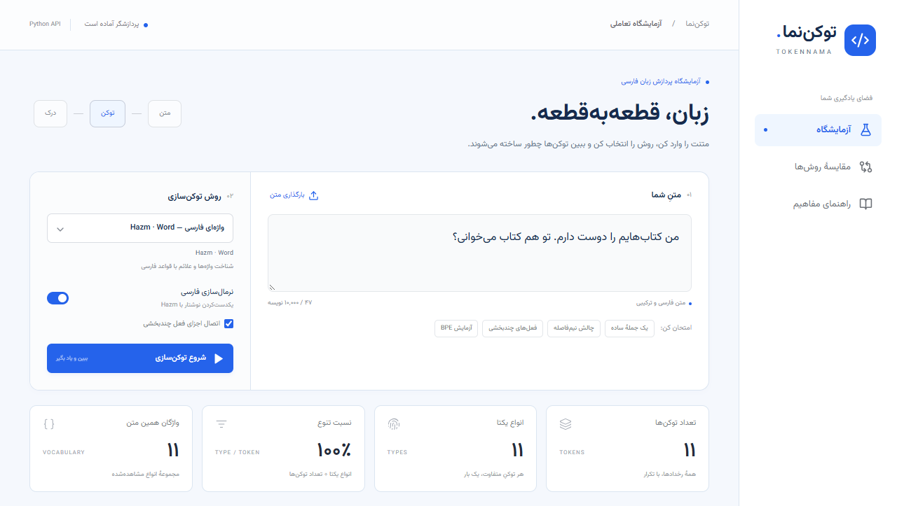
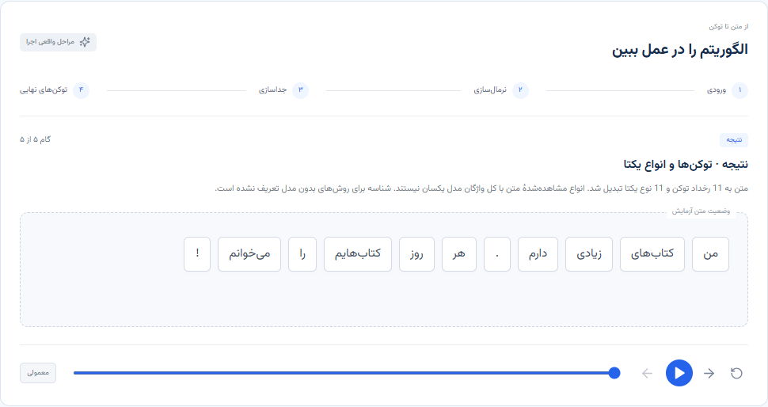
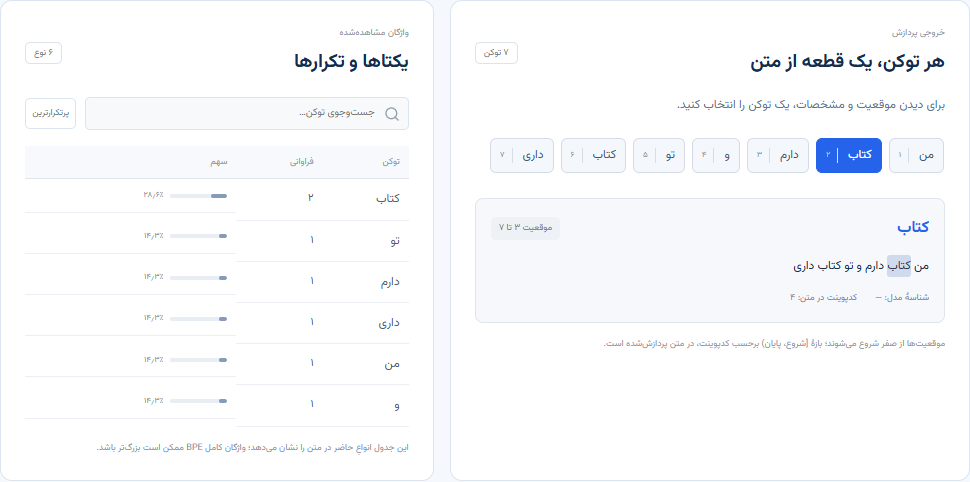
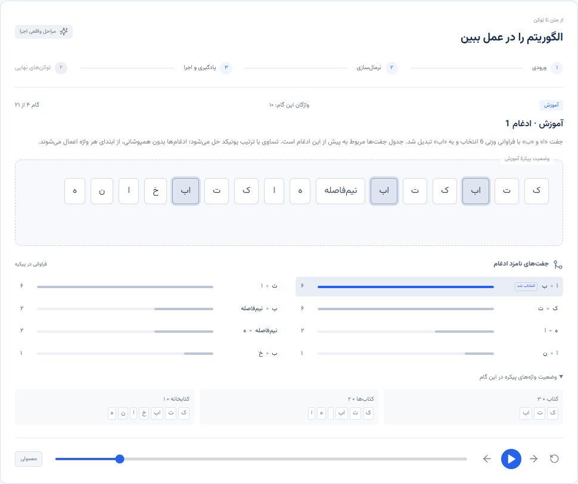
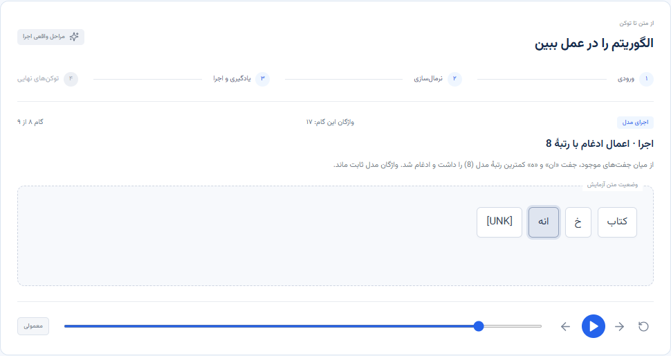
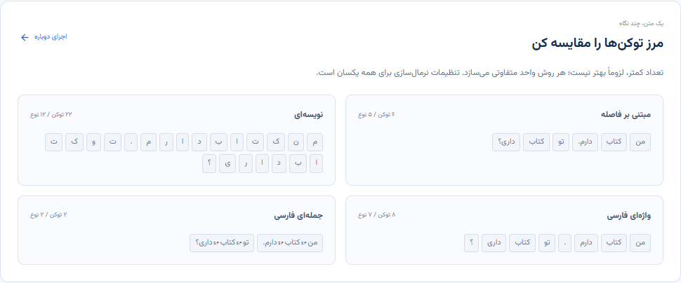

# توکن‌نما — آزمایشگاه آموزشی توکن‌سازی فارسی

توکن‌نما برای یادگیری توکن‌سازی ساخته شده است: یک جمله یا متن فارسی وارد می‌کنید، روش را انتخاب می‌کنید، خروجی را می‌بینید و مراحل ثبت‌شدهٔ الگوریتم را مرور می‌کنید. رابط فارسی است و نام فایل‌ها و ماژول‌ها برای نگهداری و انتشار در GitHub به انگلیسی انتخاب شده‌اند.

## نصب و اجرای ویندوز

اگر نسخهٔ محلی تحویل‌شده، پوشهٔ `.runtime/python312` و وابستگی‌های نصب‌شدهٔ رابط را دارد، برای اجرا کافی است روی `Start-TokenNama.cmd` دوبار کلیک کنید. اجراکننده ابتدا محیط استاندارد `backend/.venv` را بررسی می‌کند و اگر وجود نداشت، از Python همراه پروژه استفاده می‌کند.

پوشهٔ `.runtime` وارد Git نمی‌شود. برای دریافت تازه از GitHub، نصب معمول زیر را انجام دهید تا محیط مجازی مستقل پروژه ساخته شود.

پیش‌نیازها:

- Node.js نسخهٔ 22.12 یا بالاتر از یک شاخهٔ LTS پشتیبانی‌شده، به همراه npm.
- Python نسخهٔ 3.12 یا 3.13؛ نسخهٔ Hazm انتخاب‌شده با Python 3.14 سازگار نیست.
- اتصال اینترنت برای دریافت وابستگی‌ها در نصب اولیه.

در پوشهٔ پروژه، PowerShell را باز کنید و اجرا کنید:

```powershell
powershell -NoProfile -ExecutionPolicy Bypass -File scripts/setup.ps1
npm.cmd start
```

گزینهٔ `ExecutionPolicy Bypass` فقط برای همان اجرای PowerShell است و سیاست عمومی ویندوز را تغییر نمی‌دهد. محیط Python داخل `backend/.venv` ساخته می‌شود و وابستگی‌های رابط داخل `frontend/node_modules` قرار می‌گیرند.

اگر Python پیدا نشد، مسیر فایل اجرایی آن را مشخص کنید:

```powershell
powershell -NoProfile -ExecutionPolicy Bypass -File scripts/setup.ps1 -PythonPath C:/Python312/python.exe
```

پس از نصب، با دوبار کلیک روی `Start-TokenNama.cmd` برنامه باز می‌شود. پنجرهٔ اجرا را باز نگه دارید. برای توقف هر دو سرویس، در همان پنجره `Ctrl+C` بزنید.

- نشانی برنامه: [http://127.0.0.1:5173](http://127.0.0.1:5173)
- مستندات تعاملی API: [http://127.0.0.1:8000/docs](http://127.0.0.1:8000/docs)

اجرای بدون بازکردن خودکار مرورگر:

```powershell
npm.cmd run dev
```

## روش استفاده

1. یک متن فارسی وارد کنید یا یکی از مثال‌های آماده را انتخاب کنید.
2. روش توکن‌سازی را انتخاب کنید.
3. در صورت نیاز نرمال‌سازی را فعال کنید؛ تغییرات متن می‌تواند مرز و تعداد توکن‌ها را عوض کند.
4. تحلیل را اجرا کنید و با دکمه‌های مراحل، وضعیت الگوریتم را بررسی کنید.
5. جدول فراوانی و انواع یکتا را ببینید یا روش‌های پایه را روی همان متن مقایسه کنید.

برای BPE، متن آموزشی و متن ورودی نقش‌های جدا دارند. «پیکره» برای یادگیری ادغام‌هاست و «متن ورودی» با مدل حاصل توکن‌سازی می‌شود. در اجرای مدل ثابت، واژگان دوباره آموزش داده نمی‌شود.

## راهنمای تصویری

از واردکردن متن تا بررسی توکن‌ها پیش بروید؛ سپس تفاوت آموزش BPE و اجرای آن با مدل ثابت را ببینید.

### ۱. واردکردن متن و انتخاب روش



یک جملهٔ فارسی وارد کنید یا فایل متنی بارگذاری کنید، سپس روش توکن‌سازی و گزینه‌های آن را انتخاب کنید. با فعال‌کردن نرمال‌سازی Hazm، ورودی پیش از توکن‌سازی یکدست می‌شود.

### ۲. بررسی خروجی توکن‌سازی Hazm



با جابه‌جایی بین مراحل ثبت‌شده، متن پردازش‌شده و توکن‌های خروجی Hazm را بررسی کنید. این مراحل، فراخوانی‌ها و خروجی‌های واقعی کتابخانه را نشان می‌دهند و شامل تمام قواعد داخلی Hazm نیستند.

### ۳. بررسی توکن‌ها، انواع یکتا و فراوانی



برای متن `من کتاب دارم و تو کتاب داری`، روش مبتنی بر فاصله با نرمال‌سازی خاموش **۷ توکن** و **۶ نوع یکتا** تولید می‌کند؛ «کتاب» دو بار تکرار شده است. با انتخاب هر توکن، بازهٔ آن در متن پردازش‌شده برجسته می‌شود و فراوانی‌اش را می‌توان در جدول واژگان دید.

### ۴. دنبال‌کردن یک ادغام در آموزش BPE



BPE جفت‌های مجاور را در پیکره با احتساب فراوانی واژه‌ها می‌شمارد و پرتکرارترین جفت را ادغام می‌کند. جدول نامزدها شمارش پیش از ادغام را نشان می‌دهد، درحالی‌که قطعات نمایش‌داده‌شده وضعیت پیکره پس از همان ادغام هستند.

### ۵. اجرای مدل ثابت BPE روی متن جدید



در حالت اجرای مدل ثابت، متن `کتابخانه 🐈` را وارد کنید تا رتبهٔ ادغام‌های آموخته‌شده روی آن اعمال شود؛ واژگان تغییر نمی‌کند. ایموجیِ خارج از الفبای آموخته‌شده به `[UNK]` تبدیل می‌شود و متن ورودی، مدل را دوباره آموزش نمی‌دهد.

### ۶. مقایسهٔ مرز توکن‌ها



چهار روش پایه را با متن و تنظیم نرمال‌سازی یکسان مقایسه کنید. واحد خروجی هر روش متفاوت است—قطعهٔ جداشده با فاصله، کدپوینت، واژه یا جمله—بنابراین کمتر بودن تعداد توکن، امتیاز کیفیت روش نیست.

[مشاهدهٔ ظاهر موبایل](images/laboratory-mobile.png).

## Token، Type و Vocabulary

در مثال زیر و با جداسازی مبتنی بر فاصله:

```text
من کتاب دارم و تو کتاب داری
```

هفت رخداد توکن داریم:

```text
من | کتاب | دارم | و | تو | کتاب | داری
```

شش نوع یکتا داریم؛ چون «کتاب» دو بار آمده است. فراوانی «کتاب» دو و نسبت Type به Token برابر با `۶÷۷` است.

- **Token:** یک رخداد از واحدی که روش انتخاب‌شده تولید می‌کند.
- **Type:** یک مقدار یکتای مشاهده‌شده در خروجی همین متن.
- **Frequency:** تعداد تکرار یک Type.
- **TTR:** تعداد انواع یکتا تقسیم بر تعداد رخدادهای توکن.
- **Model vocabulary:** کل قطعات واژگان یک توکنایزر آموزش‌دیده؛ ممکن است بخشی از آن‌ها در متن فعلی دیده نشوند.
- **Token ID:** شناسهٔ قطعه در واژگان مدل. Hazm به‌تنهایی یک مدل واژگان شناسه‌دار مشابه BPE نیست.
- **Unknown token:** قطعه‌ای که مدل ثابت نمی‌تواند از الفبای آموخته‌شده نمایش دهد؛ در این پیاده‌سازی BPE با `[UNK]` مشخص می‌شود.

تعداد توکن در روش جمله‌ای، تعداد جمله‌هاست. در روش نویسه‌ای، واحد شمارش کدپوینت یونیکد است. بنابراین مقایسهٔ تعدادها بدون توجه به واحد هر روش معنی آموزشی درستی ندارد و «کمتر بودن» به معنی «بهتر بودن» نیست.

## روش‌های نسخهٔ اولیه

| روش | رفتار |
| --- | --- |
| مبتنی بر فاصله | قطعات جداشده با فاصله‌های سفید را استخراج می‌کند. |
| نویسه‌ای | کدپوینت‌های یونیکد را جدا می‌کند؛ شمارش فاصله به تنظیم مربوط وابسته است. |
| واژه‌ای Hazm | توکن‌سازی واقعی Hazm و گزینهٔ اتصال اجزای فعل را استفاده می‌کند. |
| جمله‌ای Hazm | متن را به واحدهای جمله‌ای تقسیم می‌کند. |
| BPE آموزشی | از نویسه‌ها شروع می‌کند، ادغام‌ها را روی پیکره یاد می‌گیرد و سپس متن ورودی را با رتبه‌های ثابت پردازش می‌کند. |

WordPiece و Unigram در نسخهٔ اولیه پیاده‌سازی نشده‌اند.

## مراحل BPE

در حالت آموزش:

1. پیکره طبق تنظیم انتخاب‌شده نرمال می‌شود.
2. فاصله‌های سفید، مرز پیش‌توکن‌ها را مشخص می‌کنند.
3. پیش‌توکن‌ها به نویسه‌ها شکسته می‌شوند و الفبای اولیه ساخته می‌شود.
4. جفت‌های مجاور با احتساب فراوانی واژه‌ها شمارش می‌شوند.
5. پرتکرارترین جفت طبق قاعدهٔ قطعی حل تساوی انتخاب می‌شود.
6. جفت انتخاب‌شده ادغام می‌شود و وضعیت تازه ثبت می‌شود.
7. فرایند تا سقف ادغام انتخاب‌شده یا نبود جفت قابل ادغام ادامه پیدا می‌کند.

در حالت اجرای مدل ثابت، ادغام‌های آموخته‌شده به ترتیب رتبه اعمال می‌شوند. شمارش تازهٔ جفت‌های متن ورودی جایگزین آموزش قبلی نمی‌شود. اگر نویسه‌ای در الفبای اولیه نباشد، `[UNK]` تولید می‌شود.

این پیاده‌سازی در سطح نویسه است و با BPE مبتنی بر بایت مدل‌هایی مانند GPT یکسان نیست. ادغام از مرز فاصلهٔ سفید عبور نمی‌کند. علائم نگارشیِ متصل به واژه، در همین قرارداد پیش‌توکن‌سازی همراه آن می‌مانند.

## نکته‌های ویژهٔ فارسی

- نیم‌فاصله کدپوینت `U+200C` است و با فاصلهٔ معمولی فرق دارد.
- «ی» فارسی و «ي» عربی، یا «ک» فارسی و «ك» عربی، کدپوینت‌های متفاوت دارند.
- فعال‌کردن نرمال‌سازی می‌تواند شکل این حروف، فاصله‌ها و نیم‌فاصله‌ها را تغییر دهد.
- خروجی برخی افعال چندبخشی Hazm می‌تواند شامل زیرخط باشد؛ این یک قرارداد خروجی کتابخانه است.
- مختصات توکن‌ها بر اساس متن پردازش‌شده و کدپوینت‌های Python هستند. پس از نرمال‌سازی نباید آن‌ها را بدون نگاشت به مختصات متن اصلی نسبت داد.
- یک نویسهٔ دیداری ممکن است از چند کدپوینت ساخته شود. کدپوینت، خوشهٔ نویسه‌ای و بایت سه مفهوم متفاوت‌اند.

مراحل Hazm در این نسخه، ورودی و خروجی فراخوانی‌های واقعی کتابخانه را نشان می‌دهند. تمام تصمیم‌های داخلی قواعد Hazm رهگیری نمی‌شوند. ردگیری تصمیم‌به‌تصمیم برای موتور آموزشی BPE انجام می‌شود.

## آزمون و ساخت

```powershell
powershell -NoProfile -ExecutionPolicy Bypass -File scripts/check.ps1
```

این دستور آزمون‌های Python و ساخت رابط همراه با بررسی TypeScript را اجرا می‌کند. ساخت رابط خروجی را در `frontend/dist` قرار می‌دهد؛ API Python باید جداگانه در حال اجرا باشد. دستور توسعهٔ پروژه هر دو بخش را راه‌اندازی می‌کند.

اعلان وابستگی‌های Python در `backend/pyproject.toml` است. نصب و CI از `backend/requirements-dev.lock.txt` به‌عنوان محدودیت نسخه‌ها استفاده می‌کنند تا نسخه‌های بررسی‌شده نصب شوند. نسخه‌های دقیق وابستگی‌های رابط نیز در `frontend/package-lock.json` ثبت شده‌اند.

برای آزمون‌های تعاملی مرورگر، ابتدا برنامه را در پنجره‌ای جداگانه اجرا و روشن نگه دارید. اگر Microsoft Edge روی ویندوز نصب است:

```powershell
$env:PLAYWRIGHT_CHANNEL = 'msedge'
npm.cmd --prefix frontend run test:e2e
```

بدون تعیین `PLAYWRIGHT_CHANNEL`، مرورگر پیش‌فرض آزمون Chromium است. برای دریافت آن و اجرای آزمون‌ها:

```powershell
cd frontend
npx.cmd playwright install chromium
npm.cmd run test:e2e
```

دریافت مرورگر Playwright فقط برای اجرای آزمون‌های مرورگر لازم است؛ استفادهٔ عادی از برنامه به این دانلود نیاز ندارد. جزئیات بررسی انجام‌شده در [گزارش اعتبارسنجی](validation.md) ثبت شده است.

## رفع اشکال

- **پیغام پیدا نشدن Python:** نسخهٔ 3.12 یا 3.13 را نصب کنید یا `-PythonPath` بدهید. میان‌بر WindowsApps به‌تنهایی نصب کامل Python نیست.
- **پیغام پیدا نشدن وابستگی‌ها:** `scripts/setup.ps1` را اجرا کنید.
- **اشغال بودن پورت:** پنجرهٔ اجرای قبلی را با `Ctrl+C` ببندید یا برنامه‌ای را که از پورت 5173 یا 8000 استفاده می‌کند متوقف کنید.
- **خطای اتصال API در رابط:** بررسی کنید پنجرهٔ اجرا بسته نشده و سرویس Python بدون خطا شروع شده است.
- **خطای دانلود هنگام نصب:** دسترسی شبکه به npm و PyPI را بررسی کنید و نصب را دوباره اجرا کنید.

## انتشار در GitHub

فایل‌های `.gitignore`، `.gitattributes`، تنظیمات ویرایشگر و GitHub Actions آماده‌اند. محیط مجازی، `node_modules`، فایل‌های محرمانهٔ `.env` و خروجی‌های محلی وارد Git نمی‌شوند. قبل از انتشار، آزمون‌ها را اجرا کنید و مجوز انتشار کد پروژه را انتخاب کنید. مجوزی به نام شما به‌صورت خودکار تعیین نشده است.

منابع علمی و مجوز اجزای استفاده‌شده در [فهرست منابع و اجزای ثالث](../THIRD_PARTY_NOTICES.md) آمده‌اند.
