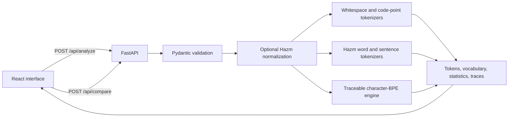

# Architecture

## Boundaries

TokenNama is a local client-server application. The browser renders the Persian educational interface; Python owns normalization, tokenization, vocabulary statistics, and algorithm traces. The frontend does not independently reconstruct algorithm decisions.

Vite proxies `/api` requests to `http://127.0.0.1:8000` during development. Both development services listen on loopback only. The API's `/docs` endpoint provides the exact request and response schemas generated from the implementation.

## Backend responsibilities

- Validate input lengths, algorithm options, merge limits, and supplied BPE models.
- Apply Hazm normalization when requested.
- Return actual tokenizer outputs and a bounded sequence of trace events.
- Compute observed types and frequencies from the resulting tokens.
- Keep trained model vocabulary separate from types observed in one input.
- Use deterministic pair selection when BPE frequencies tie.

For Hazm, trace events describe the actual library call and its output; they do not invent an internal execution history. For BPE, the engine creates trace events while it performs pair counting and merging.

## API overview

| Endpoint | Purpose |
| --- | --- |
| `GET /api/health` | Readiness and service information |
| `POST /api/analyze` | Analyze one text using the selected tokenizer |
| `POST /api/compare` | Run the basic tokenizers on the same text |

The analysis request selects `whitespace`, `character`, `hazm_word`, `hazm_sentence`, or `bpe`. Additional fields control normalization, character whitespace inclusion, Hazm verb-part joining, and BPE training or encoding.

The response carries the original and processed text, ordered tokens, observed vocabulary entries, statistics, trace events, warnings, and a BPE model when relevant. Each token includes an index and a processed-text span; model IDs are present only where a learned vocabulary supplies them.

Trace events carry a phase, Persian title and explanation, current tokens, focused indices, and optional BPE pair counts, selected pair, corpus preview, or vocabulary size. Playback changes the selected event; it does not rerun training in the browser.

## BPE contract

The implementation uses Unicode characters and whitespace-delimited pre-tokens. It does not merge across whitespace boundaries or provide byte fallback. The learned model contains its version, normalization setting, base alphabet, ordered merge rules, and vocabulary.

Training and inference are distinct operations:

- **Training** aggregates the corpus frequencies and learns ordered merges.
- **Encoding** applies the learned merge ranks to the input. It does not update the model.

An input character outside the model's base alphabet becomes `[UNK]`. The tokenizer's normalization setting must agree with the model to keep the training and inference contracts consistent.

## Text coordinates

Backend offsets use Python string indices, measured in Unicode code points, against the processed text. JavaScript string indexing uses UTF-16 code units, so frontend highlighting must convert the text to a code-point array before using those spans. Normalization can change text length; processed offsets cannot be reused against the original text without a separate alignment mapping.

The current application does not claim reversible normalization. Preserving a tokenizer model also does not preserve the original whitespace layout of a text.

## Development and verification

`scripts/dev.mjs` starts the project-local Python interpreter and Vite directly, avoiding dependency on virtual-environment activation. On Windows it prefers `backend/.venv/Scripts/python.exe` and falls back to `.runtime/python312/python.exe` for a prepared local delivery. The bundled runtime is excluded from Git and is not bootstrapped by the normal setup script. `scripts/check.ps1` uses the same interpreter preference.

The launcher checks the fixed ports before starting and stops both children when interrupted. `scripts/setup.ps1` installs dependencies locally, and `scripts/check.ps1` runs backend tests and the frontend production build.

The CI workflow performs the same backend and frontend checks on Ubuntu. Build output, Python environments, local exports, and dependency directories are ignored by Git.

Future tokenizer families should implement the same result and trace contract, with trace events produced by the algorithm itself. WordPiece and Unigram require their own teaching models and visual states; neither should reuse a BPE animation as a substitute for its actual decisions.
